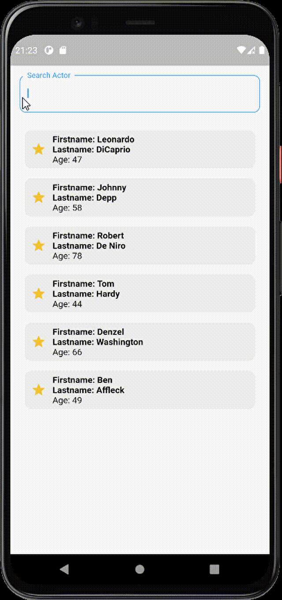

# Searchable ListView

<p align="center">
  
</p>

An easy-to-use Flutter widget for adding a searchable, sortable, and paginated list UI. Supports synchronous lists, asynchronous data sources, expansion groups, slivers, pull-to-refresh, a built-in search engine, a controller, and many customization options.

```text
Package: searchable_listview
```

## Features

- Filter lists on edit or submit
- Built-in search: pass your searchable fields and let the widget filter for you (no `filter` callback needed)
- Search strategies: `startsWith`, `endsWith` and `contain`
- `SearchableListController` to filter, clear, scroll and observe the list from outside the widget
- Support for async data sources and async filtering
- Expansion-group lists with searchable group contents
- Optional sort widget and custom sort predicate
- Pagination and `onPaginate` callback
- Pull-to-refresh support
- Sliver-based scrolling effect
- Customizable loading / error / empty widgets
- Customizable search field (decoration, input type, icons, width/height)
- Auto-complete hints and secondary widgets next to the search field

## Installation

Add the package to your `pubspec.yaml`:

```yaml
dependencies:
  searchable_listview: ^2.20.1
```

Then run:

```bash
flutter pub get
```

> **Requirements:** Dart `>=3.10.0` and Flutter `>=3.38.0`.
> If your project is on an older SDK, pub will keep resolving the latest version that supports it (`2.19.5`).

## Quick Start

Basic synchronous list example:

```dart
SearchableList<Actor>(
  initialList: actors,
  itemBuilder: (actor) => ActorItem(actor: actor),
  filter: (query) => actors
      .where((a) => a.name.toLowerCase().contains(query.toLowerCase()))
      .toList(),
  emptyWidget: const Center(child: Text('No results')),
  inputDecoration: InputDecoration(labelText: 'Search actor'),
)
```

### Built-in search (no filter callback)

You don't have to write the `filter` callback anymore. Tell the widget **which fields** of your model should be searched with `searchableFields`, and **how** to match them with `searchStrategy`:

```dart
import 'package:searchable_listview/resources/arrays.dart';

SearchableList<Actor>(
  itemBuilder: (item) {
    return ActorItem(actor: item);
  },
  initialList: actors,
  searchableFields: (actor) => [actor.name],
  searchStrategy: SearchStrategy.endsWith,
)
```

`searchableFields` can return one or several fields. An item is kept when **any** of its fields matches the query:

```dart
SearchableList<Actor>(
  initialList: actors,
  itemBuilder: (actor) => ActorItem(actor: actor),
  searchableFields: (actor) => [actor.name, actor.lastName],
  searchStrategy: SearchStrategy.contain,
)
```

Available search strategies:

| Strategy | Keeps the item when the field... |
|---|---|
| `SearchStrategy.startsWith` (default) | starts with the query |
| `SearchStrategy.endsWith` | ends with the query |
| `SearchStrategy.contain` | contains the query anywhere |

Good to know:

- Matching is case-insensitive.
- Fields are compared using their `toString()` value, so numbers and other types work too (for example `searchableFields: (actor) => [actor.age]`).
- When `searchableFields` is provided it is used instead of the `filter` callback. Keep using `filter` when you need fully custom logic.
- `searchableFields` and `searchStrategy` are available on every constructor (default, `.async`, `.expansion` and `.sliver`).

### Controller

Pass a `SearchableListController` to drive the list from your own code:

```dart
final controller = SearchableListController<Actor>();

SearchableList<Actor>(
  controller: controller,
  initialList: actors,
  itemBuilder: (actor) => ActorItem(actor: actor),
  searchableFields: (actor) => [actor.name, actor.lastName],
)
```

Then use it anywhere (a button, a chip, a screen event...):

```dart
controller.filter('tom');                  
controller.clear();                        
controller.scrollToTop(animate: true);    
controller.scrollTo(300);                 
controller.updateSearchStrategy(SearchStrategy.contain); 
```

The controller is also a `ValueNotifier`, so you can listen to what the list is showing (the current query, the filtered results and the status):

```dart
ValueListenableBuilder(
  valueListenable: controller,
  builder: (context, value, _) {
    return Text('${value.results.length} results for "${value.query}"');
  },
)
```

You can also read `controller.query`, `controller.results`, `controller.status` (`idle`, `loading`, `data`, `empty` or `error`), `controller.scrollPosition` and `controller.isAttached` directly.

Notes:

- The controller does nothing until it is attached to a `SearchableList` (`controller.isAttached`).
- You create the controller, so you are the one who disposes it (`controller.dispose()`).

### Changing the search strategy on the fly

```dart
DropdownButton<SearchStrategy>(
  value: strategy,
  items: const [
    DropdownMenuItem(value: SearchStrategy.startsWith, child: Text('Starts with')),
    DropdownMenuItem(value: SearchStrategy.endsWith, child: Text('Ends with')),
    DropdownMenuItem(value: SearchStrategy.contain, child: Text('Contains')),
  ],
  onChanged: (selected) {
    if (selected == null) return;
    setState(() => strategy = selected);
    controller.updateSearchStrategy(selected); // the list is filtered again right away
  },
)
```

### Async list example

Use the `.async` constructor when data comes from a Future and you need to filter the returned list:

```dart
SearchableList<Actor>.async(
  asyncListCallback: () async => await fetchActors(),
  asyncListFilter: (query, list) =>
      list.where((a) => a.name.contains(query)).toList(),
  itemBuilder: (actor) => ActorItem(actor: actor),
  loadingWidget: const Center(child: CircularProgressIndicator()),
  errorWidget: const Center(child: Icon(Icons.error)),
)
```

### Expansion groups

For grouped/expansion lists use the `.expansion` constructor:

```dart
SearchableList<Actor>.expansion(
  expansionListData: mapOfActors,
  expansionTitleBuilder: (key) => Text(key.toString()),
  filterExpansionData: (query) => {
    for (final entry in mapOfActors.entries)
      entry.key: (mapOfActors[entry.key] ?? [])
          .where((a) => a.name.contains(query))
          .toList()
  },
  expansionListBuilder: (index, actor) => ActorItem(actor: actor),
)
```

### Sliver list

Use `.sliver` to embed a searchable list inside sliver scroll views:

```dart
SearchableList<Actor>.sliver(
  initialList: actors,
  itemBuilder: (actor) => ActorItem(actor: actor),
  searchableFields: (actor) => [actor.name],
)
```

## Common Parameters

- `initialList` — initial synchronous list of items
- `filter` — optional synchronous filter callback (String -> List<T>), not needed when you use `searchableFields`
- `searchableFields` — the field(s) of your model to search in (`T -> List<dynamic>`)
- `searchStrategy` — how the fields are matched: `startsWith` (default), `endsWith` or `contain`
- `controller` — a `SearchableListController` to filter, clear, scroll and observe the list
- `asyncListCallback` — Future that returns a List<T>
- `asyncListFilter` — filter that applies to results from `asyncListCallback`
- `itemBuilder` — builder for list item widgets
- `emptyWidget`, `loadingWidget`, `errorWidget` — custom widgets for states
- `onPaginate` — callback when list reaches the end (for pagination)
- `inputDecoration`, `textStyle`, `textInputType` — search field customization
- `sortWidget`, `sortPredicate` — optional sorting UI and comparator
- `closeKeyboardWhenScrolling` — whether scrolling hides the keyboard

For a complete list of available parameters and detailed API, see the library documentation or the source code in `lib/searchable_listview.dart`.

## Example App

See the `example/` folder for a runnable demo with multiple configurations and screenshots, including the built-in search with a live search strategy switcher.

<p align="center">
  
</p>

## Contributing

Contributions, issues and feature requests are welcome. Feel free to check the `example/` folder for usage examples and open a pull request.

- Report bugs by opening an issue
- Suggest features by opening an issue
- Submit pull requests for fixes and improvements

Please read the [contributing guide](CONTRIBUTING.md) before you open a pull request.

Repository: <https://github.com/koukibadr/Searchable-Listview>

## License

This project is licensed under the terms in the `LICENSE` file.

## Contributors

<a href="https://github.com/koukibadr/Searchable-Listview/graphs/contributors">
  
</a>
